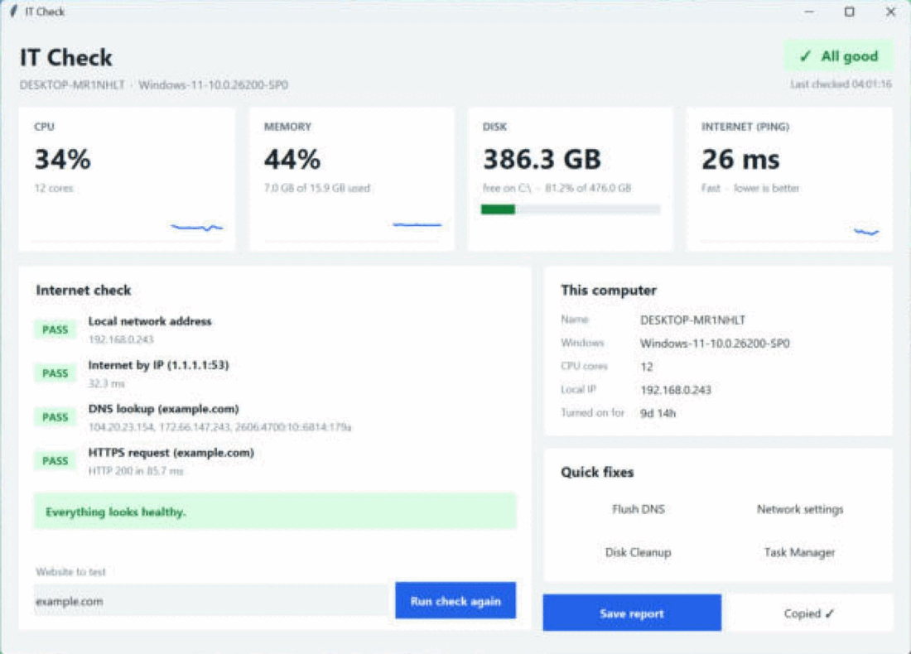

# IT Support Toolkit

A small app, a command-line tool, and a set of checklists for everyday IT support work: slow computers, "the internet is down" calls, new laptop setups, and point-of-sale (POS) installs.

Everything uses only the Python standard library (the window uses tkinter, which comes with Python), so there is nothing to install besides Python. The tests run on Python 3.10 and 3.12 on Windows and Linux through GitHub Actions.

Built by Omar Aldaihani, computer engineering graduate (University of Hartford, 2023).

## Why this exists

When someone says "the internet isn't working," a technician checks things in a fixed order: is there a network address, can the computer reach the internet, does DNS work, does a website answer. `itcheck` runs those steps for you and says in plain words where the problem is.

## The app



**Easiest way:** download `ITCheck.exe` from the [Releases](../../releases/latest) page and double-click it. Nothing to install: Python is built into the file, so it runs on any Windows 10 or 11 PC.

> The first time you run it, Windows may say **"Windows protected your PC"** because the app is not code-signed. Click **More info**, then **Run anyway**.

**With Python:** double-click `Start IT Check.bat`, or run:

```
python itcheck_gui.py
```

As soon as the window opens it checks everything by itself:

- **Live tiles** for CPU, memory, disk space and internet speed (ping), each with a small graph of the last minute. They turn amber, then red, when something needs attention.
- **Internet check**: the 4-step check with a green PASS or red FAIL for each step and a one-sentence diagnosis. It runs again every minute, or when you click **Run check again**.
- **Status badge** at the top: "All good", or how many issues were found (no internet, almost-full disk, memory over 90%).
- **This computer**: name, Windows version, CPU cores, local IP address and how long the PC has been on.
- **Quick fixes**: one click to flush the DNS cache, open Network settings, run Disk Cleanup or open Task Manager.
- **Save report** writes a Markdown report for a support ticket; **Copy summary** puts a short text summary on the clipboard, ready to paste into a chat.

### Build the .exe yourself

Double-click `build_exe.bat` on a Windows PC that has Python. It installs PyInstaller and creates `dist\ITCheck.exe`, a single file that runs on any Windows PC without Python and without a console window.

### Browser version

`python itcheck_app.py` opens an older version of the dashboard in your web browser. It only listens on `127.0.0.1`, so nobody else on the network can open it.

## What the command-line tool does

| Command | What it does |
| --- | --- |
| `sysinfo` | Shows the computer name, operating system, CPU cores, and local IP address |
| `disk` | Shows disk usage and warns when less than 10% of the disk is free |
| `net` | Checks the network step by step and gives a one-line diagnosis |
| `report` | Combines everything into a Markdown report you can paste into a support ticket |

## How to run it

1. Install Python 3.10 or newer from [python.org](https://www.python.org/downloads/).
2. Download this repository (green **Code** button on GitHub, then **Download ZIP**) and open a terminal in the folder.
3. Run a command:

```
python itcheck.py sysinfo
python itcheck.py disk
python itcheck.py net
python itcheck.py net --host google.com
python itcheck.py report --output report.md
```

Add `--json` to `sysinfo`, `disk`, or `net` if you want output another program can read. On Windows, use `py` instead of `python` if `python` is not recognised.

## Example: a computer with no internet access

This is real output from a machine that could not reach the internet:

```
[PASS] Local network address            192.0.2.2
[FAIL] Internet by IP (1.1.1.1:53)      timed out
[FAIL] DNS lookup (example.com)         [Errno -2] Name or service not known
[FAIL] HTTPS request (example.com)      Tunnel connection failed: 403 Forbidden

Diagnosis: Connected locally but no internet. Check the router, the modem, or the internet provider.
```

The tool exits with code 0 when every check passes and 1 when something fails, so it can also be used in scripts.

## How the diagnosis works

| Step | Check | If it fails |
| --- | --- | --- |
| 1 | The computer has a local network address | Cable, Wi-Fi, or network adapter problem |
| 2 | It can open a connection to 1.1.1.1 by IP address | Router, modem, or internet provider problem |
| 3 | It can turn a website name into an IP address | DNS problem |
| 4 | A real website answers over HTTPS | Site is down, or a firewall or proxy is blocking it |

## Checklists

Written troubleshooting guides are in the [`docs`](docs) folder:

- [No internet on a Windows PC](docs/no-internet-checklist.md)
- [Slow Windows PC](docs/slow-pc-checklist.md)
- [Setting up a new laptop for an employee](docs/new-laptop-setup-checklist.md)
- [Setting up a POS system for a small business](docs/pos-setup-checklist.md)

## Run the tests

```
python -m unittest discover -s tests -v
```

The tests check the diagnosis logic, the TCP check against a local test server, disk usage, the report output, the command line, the desktop app's status and summary logic, the live CPU and memory readings, and the browser app's web server. They need no internet connection.

## Ideas for next versions

- Check that a printer on the network answers on its port
- Test a list of hosts from a file
- Add a Wi-Fi signal check on Windows
- Save results to a CSV file for tracking over time

## License

MIT. See [LICENSE](LICENSE).
